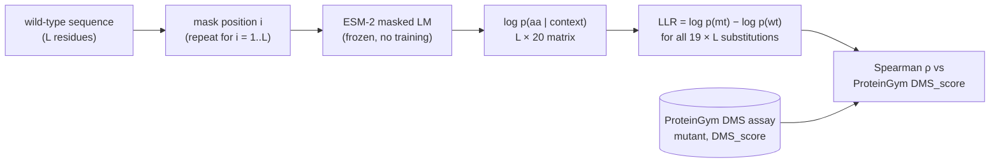
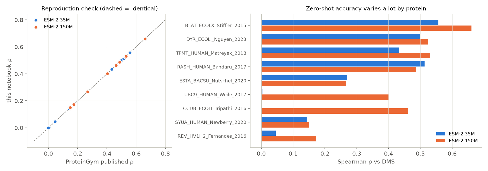
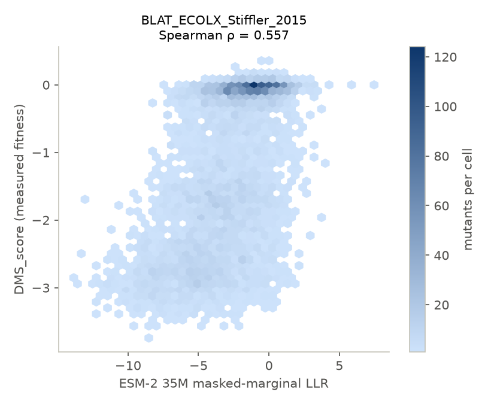
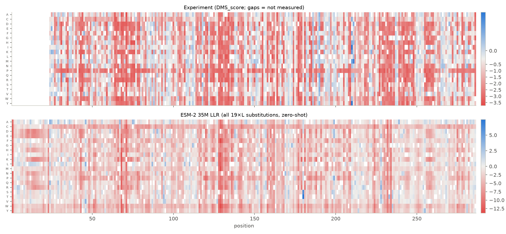
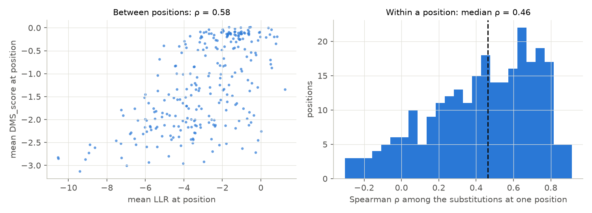
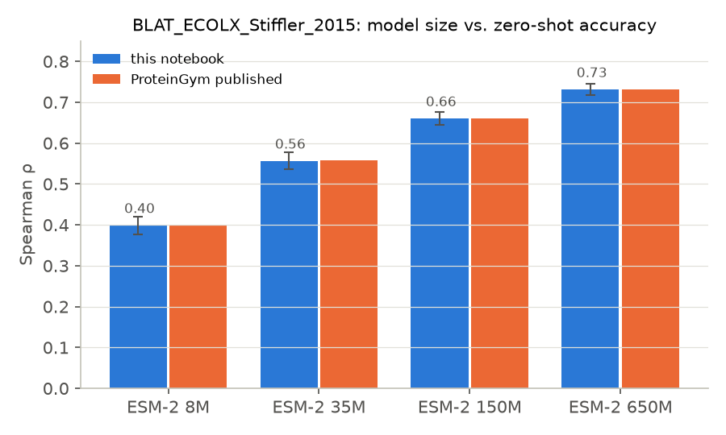
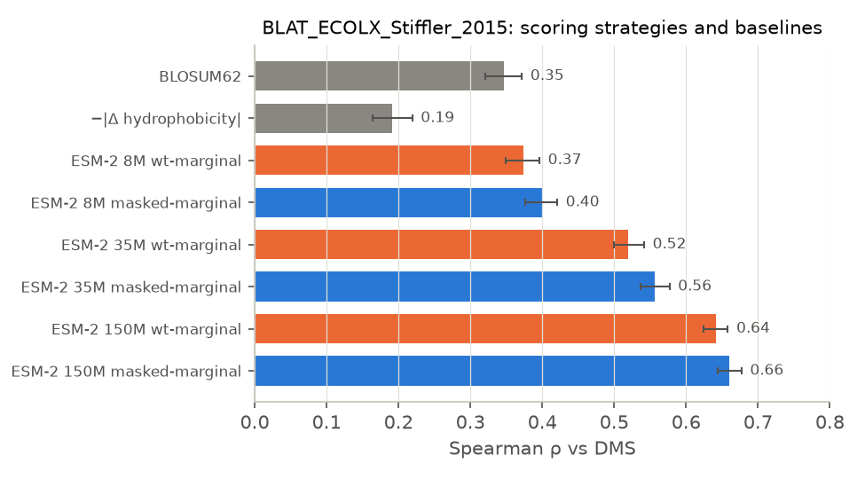

# Zero-shot variant effect prediction with ESM-2

[`zero_shot_variant_effects.ipynb`](zero_shot_variant_effects.ipynb) uses **ESM-2**, a protein language model, to predict which single amino-acid substitutions damage a protein. It does this **without any training and without seeing a single fitness measurement**. The predictions are then benchmarked against deep mutational scanning (DMS) experiments from **ProteinGym**.

The question it answers:

> A model trained only to fill in masked amino acids in natural sequences. Does it "know" which mutations break a protein?

The answer is yes, to a useful degree. On TEM-1 β-lactamase (~5,000 mutants), ESM-2 650M ranks mutations with Spearman ρ = 0.73 against the experiment, and every number reproduces the published ProteinGym leaderboard exactly.

This complements the [protein_embedding](../protein_embedding/) project. That project used ESM-2's **hidden states** as features. This one uses its **output head**: the probability it assigns to each amino acid.

---

## 1. The idea

Evolution has already run a huge mutational experiment. Substitutions that break a protein get purged, so they are rare in the sequence databases ESM-2 was trained on (UniRef50). If the model has learned those statistics, its surprise at a mutation should track how harmful the mutation is.

**Masked-marginal log-likelihood ratio** (Meier et al., 2021, *"Language models enable zero-shot prediction of the effects of mutations on protein function"*):

```
score(wt → mt at position i) = log p(x_i = mt | sequence with i masked)
                             − log p(x_i = wt | sequence with i masked)
```

* **score < 0**: the model finds the mutant less plausible than wild type, so the mutation is predicted to be damaging.
* **score ≈ 0**: neutral.
* **score > 0**: the model prefers the mutant. This happens at positions where the wild-type residue is unusual.



A protein of length *L* needs *L* forward passes, which the notebook batches 8 at a time. The result is a score for **every** possible single mutant, including the ones the experiment did not measure.

---

## 2. Data: ProteinGym

[ProteinGym](https://proteingym.org) (Notin et al., NeurIPS 2023) is the standard benchmark for variant effect prediction. It contains 217 substitution DMS assays in one shared format:

| Column | Meaning |
|---|---|
| `mutant` | e.g. `H24C`: wild-type H at position 24 (1-based) mutated to C. Multi-mutants are joined with `:` |
| `DMS_score` | measured fitness, where higher means fitter. The scale is assay-specific |
| `DMS_score_bin` | 1 = fit, 0 = not fit (ProteinGym's own cutoff) |

The notebook also downloads ProteinGym's reference table (wild-type sequence for each assay) and the **published zero-shot Spearman of ~90 models for each assay**. Those published values are used to check this implementation.

**Main assay:** `BLAT_ECOLX_Stiffler_2015` is TEM-1 β-lactamase from *E. coli*, 286 aa. Fitness is bacterial growth on ampicillin. 4,996 single mutants cover 92% of all possible substitutions. The first 23 residues (the signal peptide) were not mutated.

---

## 3. Notebook walkthrough

| § | Section | What happens | Concept |
|---|---|---|---|
| 0 | Setup | Imports, model list (8M → 650M), plotting style | Hugging Face `EsmForMaskedLM` |
| 1 | Data | Downloads the ProteinGym reference table, leaderboard and DMS zip (cached in `data/`), parses mutant strings, **checks that every wild-type letter matches the reference sequence** | Benchmark data hygiene |
| 2 | Scoring | `logprob_matrix()` masks each position and collects log-probs for the 20 amino acids. `llr_matrix()` turns them into LLRs. Results are cached as `.npy` | **Masked-marginal scoring** |
| 3 | Benchmark | Spearman ρ, bootstrap 95% CI, AUC on binary labels, hexbin scatter, comparison with the published value | Rank correlation, uncertainty |
| 4 | Landscape | Side-by-side heatmaps (experiment vs model, position × amino acid). Correlation split into *between positions* and *within a position* | What kind of signal the model has |
| 5 | Model size | Same assay scored with ESM-2 8M, 35M, 150M and 650M | Scaling |
| 6 | Cheaper score + baselines | Wild-type marginal (1 forward pass instead of L), BLOSUM62, hydrophobicity change | Always compare to a cheap baseline |
| 7 | Nine-assay panel | 35M and 150M on 9 assays across fitness types and organisms. Reproduction check against all published values | Don't trust a single benchmark |
| 8 | Takeaways | Summary | |

**Runtime** (Intel i7 laptop CPU, no GPU), for a full scan of the 286-aa protein: 8M about 16 s, 35M about 47 s, 150M about 2.8 min, 650M about 9 min. The panel in §7 adds about 9 min. Everything is cached in `data/scores/`, so a re-run takes about 1 minute.

**Kernel:** `glm_test` (Python 3.12, torch 2.2, transformers 4.41, scikit-learn, scipy, matplotlib).

---

## 4. Results (from the saved run)

### 4.1 The implementation is correct

Each of the 17 Spearman values computed here (4 model sizes on β-lactamase, plus 2 sizes × 9 assays in the panel, with β-lactamase in both) **matches ProteinGym's published value to 3 decimal places**. This is the most important check in the notebook. Off-by-one indexing, a missing `<cls>` offset, or scoring the wrong token would all show up here as a mismatch.



### 4.2 β-lactamase: ESM-2 35M

| Metric | Value |
|---|---|
| Spearman ρ | **0.557** (95% bootstrap CI 0.537–0.577) |
| AUC (fit vs not fit) | 0.782 |
| ProteinGym published | 0.557 |



The DMS scores are **bimodal**: a cluster near 0 (wild-type-like) and a broad tail of dead variants. The model separates the two groups well, but within the dead group the ranking is noisy. That is one reason the field uses rank correlation rather than Pearson.

At the catalytic serine (S68, which is S70 in standard Ambler numbering), the model puts p = 0.996 on serine. Every substitution there gets an LLR below −6. The model has clearly learned the active site.

### 4.3 The mutational landscape



Red columns are positions that tolerate nothing. Many of them line up between the experiment (top) and the model (bottom), and the model also scores the 23 signal-peptide residues the experiment never touched. The proline row is red almost everywhere in the experiment, which matches the model's general dislike of prolines inside secondary structure.

| Correlation | ρ |
|---|---|
| Global (all 4,996 mutants) | 0.557 |
| Between positions (mean score per site, 263 sites) | 0.583 |
| Within a position (median across 263 sites) | 0.463 |



The model is not only flagging "important positions". Even among the substitutions at one site, it ranks them reasonably well (median ρ ≈ 0.46), although the spread across sites is wide (−0.3 to 0.9).

### 4.4 Model size



| ESM-2 | Params | ρ (ours) | 95% CI | AUC | Published |
|---|---|---|---|---|---|
| 8M | 8M | 0.399 | 0.376–0.421 | 0.704 | 0.399 |
| 35M | 35M | 0.557 | 0.537–0.577 | 0.782 | 0.557 |
| 150M | 150M | 0.661 | 0.644–0.677 | 0.839 | 0.661 |
| 650M | 650M | **0.731** | 0.717–0.746 | 0.883 | 0.731 |

On this protein the gain is steady with no sign of leveling off. Across all 217 ProteinGym assays it does level off: the mean per-assay ρ is 0.206 (8M), 0.319 (35M), 0.401 (150M), 0.438 (650M), 0.432 (3B) and 0.425 (15B), computed from `data/published_spearman.csv`. This assay is one of the friendly ones.

### 4.5 Scoring strategy and baselines



| Score | ρ |
|---|---|
| −\|Δ hydrophobicity\| | 0.191 |
| BLOSUM62 | 0.346 |
| ESM-2 8M wt-marginal / masked | 0.374 / 0.399 |
| ESM-2 35M wt-marginal / masked | 0.520 / 0.557 |
| ESM-2 150M wt-marginal / masked | 0.641 / 0.661 |

* **BLOSUM62 is a strong baseline** (0.35). It knows nothing about this protein, only which amino acids generally swap well. The 8M model barely beats it, so a tiny PLM adds little beyond generic substitution chemistry.
* **Wild-type marginal** costs 1 forward pass instead of 286, which here means 1 s instead of 47 s. It loses only about 0.02–0.04 ρ. The gap is small because the model can see the wild-type residue and is slightly biased toward it. For large-scale screening, it is the practical choice.

### 4.6 Nine-assay panel (35M / 150M)

| Assay | Protein | Readout | ρ 35M | ρ 150M |
|---|---|---|---|---|
| BLAT_ECOLX_Stiffler_2015 | β-lactamase (*E. coli*) | growth | 0.557 | 0.661 |
| DYR_ECOLI_Nguyen_2023 | DHFR (*E. coli*) | growth | 0.500 | 0.525 |
| TPMT_HUMAN_Matreyek_2018 | TPMT (human) | abundance | 0.433 | 0.531 |
| RASH_HUMAN_Bandaru_2017 | H-Ras (human) | activity | 0.514 | 0.487 |
| ESTA_BACSU_Nutschel_2020 | lipase A (*B. subtilis*) | stability | 0.270 | 0.267 |
| UBC9_HUMAN_Weile_2017 | UBC9 (human) | yeast complementation | **0.004** | 0.403 |
| CCDB_ECOLI_Tripathi_2016 | CcdB toxin (*E. coli*) | toxicity | **−0.001** | 0.462 |
| SYUA_HUMAN_Newberry_2020 | α-synuclein (human) | yeast toxicity | 0.142 | 0.150 |
| REV_HV1H2_Fernandes_2016 | HIV-1 Rev | viral replication | 0.046 | 0.173 |
| **Mean** | | | **0.274** | **0.407** |

Patterns:
* **Small models can fail completely.** On UBC9 and CcdB, 35M gives ρ ≈ 0, and 150M jumps to 0.40–0.46. Below some capacity, the model doesn't model these families at all.
* **Some assays stay hard at every size.** α-synuclein is intrinsically disordered, so there is little structural constraint for evolution to encode, and the assay measures *toxicity*, which isn't the protein's natural function. HIV Rev is a fast-evolving viral protein with few homologs in UniRef. These are known weak spots for PLMs. MSA-based and structure-aware models (EVE, GEMME, SaProt) tend to do better there.
* **Bigger isn't always better.** For H-Ras and lipase A, 150M ≤ 35M.

---

## 5. Conclusions

1. **Sequence statistics alone carry real fitness signal.** With no labels and no training, ESM-2 ranks β-lactamase mutants at ρ = 0.56 (35M) to 0.73 (650M). For scale, ProteinGym has three independent DMS studies of the same protein. Stiffler 2015 and Firnberg 2014 agree with each other at ρ = 0.94, but Deng 2012 agrees with either one at only about 0.61. So ESM-2 650M (0.73 against Stiffler) agrees with that experiment better than one wet-lab study agrees with another.
2. **The model captures both which sites matter and which substitutions are tolerated at a site.**
3. **Scale helps on average, but performance depends heavily on the protein.** Across 9 assays, ρ ranges from 0.0 to 0.66 for the same model.
4. **How to benchmark well:**
   * Verify the wild-type alignment before scoring.
   * Use **rank** correlation, because DMS scales are arbitrary and non-linear.
   * Report a **confidence interval**. With ~5,000 mutants it is about ±0.02, so smaller differences mean nothing.
   * Beat a **trivial baseline** (BLOSUM62 already gets 0.35).
   * **Reproduce a published number** before trusting your own.
   * Evaluate on **many assays**, because a single assay can flatter or punish any method.

---

## 6. Caveats

* **Spearman on one assay is noisy as a measure of model quality.** ProteinGym's leaderboard averages over 217 assays, grouped first by UniProt ID and function type. The 9-assay panel here is a sample chosen to show the spread, including known failures. It is not a fair average.
* **Panel assays were filtered** to single-mutant-only assays of ≤ 300 aa to keep CPU time low. Assays with multi-mutants (e.g. GFP) need a scoring rule for combining mutations (ProteinGym sums the single-site LLRs), and sequences > 1,022 aa need a sliding window.
* **Data leakage is minimal but not zero.** ESM-2 never saw DMS data, but it was trained on UniRef50, which contains these proteins' wild-type sequences and homologs. That is the point of the method, but it means performance depends on how well each family is represented in UniRef.

---

## 7. Things to try next

1. **ESM-2 3B / ESM-C / ESM-1v ensemble.** These are on Hugging Face. 3B is too slow for this CPU, but it runs on a free Colab GPU.
2. **Multi-mutants.** Score `GFP_AEQVI_Sarkisyan_2016` by summing single-site LLRs, and check where additivity breaks down (epistasis).
3. **Pseudo-log-likelihood** of each full mutant sequence (mask every position of the mutant). It is slower, but it handles insertions and deletions.
4. **Supervised on top of zero-shot.** Use 10% of the DMS labels to train a ridge regression on ESM-2 embeddings plus the zero-shot score, and see how much a few labels add. This is the bridge to the protein_embedding project.
5. **Compare to an MSA model.** Download EVE or GEMME scores from ProteinGym for the same assays and see where evolution-from-alignment beats the PLM.
6. **Per-region analysis.** Map ρ onto the structure (PDB 1ZG4) and check whether errors cluster at the surface, the active site or the core.

---

## 8. Files

```
zero_shot_variant_effects/
├── zero_shot_variant_effects.ipynb   # the notebook (saved with outputs)
├── README.md                         # this file
├── data/
│   ├── DMS_substitutions.csv         # ProteinGym reference table (wild-type sequences)
│   ├── published_spearman.csv        # ProteinGym zero-shot leaderboard, per assay
│   ├── DMS_ProteinGym_substitutions.zip  # 43 MB, all 217 assays (gitignored)
│   ├── dms/                          # the extracted assays used here
│   └── scores/                       # cached L × 20 log-prob matrices, <assay>__<model>__<masked|wt>.npy
└── figs/                             # plots used above
```

## References

* Lin et al. (2023). *Evolutionary-scale prediction of atomic-level protein structure with a language model.* Science. (ESM-2)
* Meier et al. (2021). *Language models enable zero-shot prediction of the effects of mutations on protein function.* NeurIPS. (masked-marginal scoring)
* Notin et al. (2023). *ProteinGym: Large-scale benchmarks for protein fitness prediction and design.* NeurIPS Datasets & Benchmarks.
* Stiffler, Hekstra & Ranganathan (2015). *Evolvability as a function of purifying selection in TEM-1 β-lactamase.* Cell.
